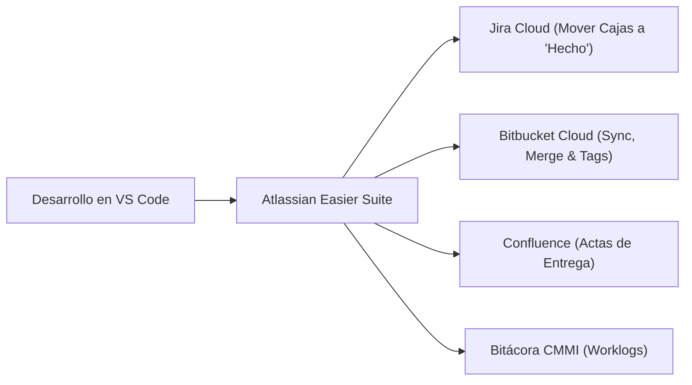
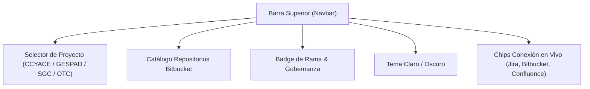
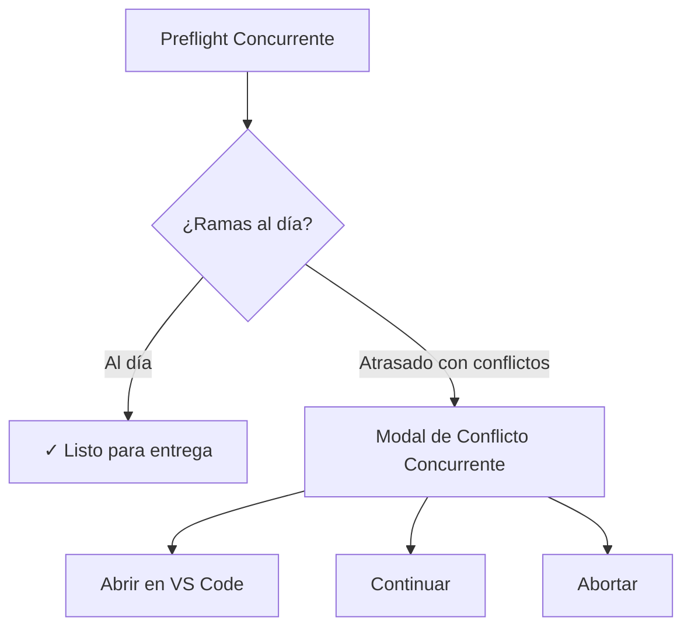

# Manual de Usuario y Operación — Atlassian Easier Suite (CMMI v3.0)

> [!NOTE]
> Documentación generada bajo el estándar **Docs-as-Code (SnapDoczilla)**, disponible de forma nativa en la carpeta local [`docs/`](file:///C:/Users/jvarasc/Documents/CODIGO/PROPUESTA_AUTOMATIZADOR_ATTLASIAN/docs) y configurable mediante [`mkdocs.yml`](file:///C:/Users/jvarasc/Documents/CODIGO/PROPUESTA_AUTOMATIZADOR_ATTLASIAN/mkdocs.yml).

---

## 🎯 Índice del Manual de Operación

1. [Visión General & Propósito del Sistema](#1-visión-general--propósito)
2. [Inicio Rápido y Lanzador Windows (`iniciar_app.bat`)](#2-inicio-rápido)
3. [Navegación e Interfaz Principal](#3-navegación-e-interfaz-principal)
4. [Tablero Jira en Vivo & Transición de Cajas](#4-tablero-jira-en-vivo)
5. [Catálogo Inteligente de Repositorios (Bitbucket Cloud & Local)](#5-catálogo-inteligente-de-repositorios)
6. [Flujo Git Concurrente & Resolución de Conflictos](#6-flujo-git-concurrente)
7. [Bitácora de Horas CMMI v3.0 (Worklogs)](#7-bitácora-de-horas-cmmi-v30)
8. [Smoke Test vs Ejecución Real](#8-smoke-test-vs-ejecución-real)
9. [Resolución de Problemas Frecuentes (Troubleshooting)](#9-resolución-de-problemas-frecuentes)

---

## 1. Visión General & Propósito

**Atlassian Easier Suite** es una aplicación de escritorio diseñada para eliminar las fricciones en la entrega de software empresarial:



### Problemas que Resuelve
* **Transición manual de incidencias:** Mueve en lote tarjetas desde *Por Hacer* / *En Curso* hacia *Hecho* en Jira Cloud.
* **Colisiones de Merge en ramas compartidas:** Inspecciona con *Git Preflight* las ramas remotas antes de enviar código.
* **Imputación dispersa de tiempos:** Asienta bitácoras semanales categorizadas bajo el estándar CMMI v3.0.
* **Desacople de compilación pesada:** La sincronización con Atlassian se realiza en menos de 10 segundos, dejando la compilación de instalables como un paso opcional.

---

## 2. Inicio Rápido

Para iniciar la aplicación en el entorno corporativo de Windows:

```cmd
iniciar_app.bat
```

> [!IMPORTANT]
> El archivo por lotes `iniciar_app.bat` está optimizado para evitar bloqueos de directiva de grupo corporativo (*AppLocker*), asegurando la carga del puente seguro CommonJS [`preload.cjs`](file:///C:/Users/jvarasc/Documents/CODIGO/PROPUESTA_AUTOMATIZADOR_ATTLASIAN/dist-electron/preload.cjs).

---

## 3. Navegación e Interfaz Principal



* **Sidebar Lateral:** Acceso directo a *Pipeline & .BAT*, *Tablero Jira*, *Bitácora & Horas*, *Bitbucket & Confluence* y *Perfiles de Proyecto*.
* **Terminal Flotante:** Ubicada en la parte inferior, permanece en reposo sin saturar la pantalla. Con un clic en **`Abrir Consola`**, se expande para ver el streaming en vivo de Node.js y Git.

---

## 4. Tablero Jira en Vivo

* **Contadores en Tiempo Real:** Visualiza las cantidades exactas en **Por Hacer (Backlog)**, **En Curso (Activas)** y **Hecho (Finalizadas)**.
* **Refresco Automático:** Consulta directamente a `https://sonda.atlassian.net/rest/api/3/search` usando el JQL `project = "CCYACE" ORDER BY created DESC`.
* **Sincronización `.env`:** Si se actualiza el token en el archivo `.env.atlassian`, el botón `🔄 Sincronizar de .env` refresca las credenciales sin reiniciar la app.

---

## 5. Catálogo Inteligente de Repositorios

El modal de descubrimiento cuenta con dos pestañas de alta velocidad:

1. **Repositorios Bitbucket Cloud:**
   * Consulta el workspace corporativo `sondacode` con paginación automática (hasta 500 repositorios).
   * **Mecanismo de Resiliencia Multi-Role:** Consulta roles de miembro (`role=member`), colaborador (`role=contributor`) y workspace directo.
   * **Proyectos Clave Verificados al Tope:**
     * `cotizador-claude-corporativo` (CL Cotizador y Auditor Claude Enterprise)
     * `gespad-sii` (CL SII GESPAD)
     * `sistema_gestion_control` (CL Sistema de Gestion de Control)
     * `datalake-otasa` (CL Oleoducto Transandino Chile - OTC)
   * Permite asociar la clave de proyecto Jira (`GES`, `CCYACE`, `SGC`, `OTC`) y vincular la carpeta local antes de importar.
2. **Carpetas Locales en mi PC:**
   * Escanea subdirectorios en `C:\Users\jvarasc\Documents\CODIGO`.
   * Detecta repositorios Git activos, rama actual y archivos `.env.atlassian`.

---

## 6. Flujo Git Concurrente

Cuando varios ingenieros colaboran sobre `develop` o `main`, el **Git Preflight Engine** evalúa el estado del repositorio:



---

## 7. Bitácora de Horas CMMI v3.0

Permite registrar trabajo semanal en Jira distribuyendo el esfuerzo en 7 categorías formales:

* **REQ:** Análisis de Requerimientos.
* **TS:** Arquitectura y Diseño Técnico.
* **DEV:** Desarrollo y Codificación.
* **PR:** Revisión por Pares (Code Review).
* **VV:** Pruebas de Verificación y Validación.
* **PQA:** Documentación de Calidad y Procesos.
* **CM:** Gestión de Release y Configuración.

---

## 8. Smoke Test vs Ejecución Real

| Modo | Modifica Datos | Git Push | Mueve Cajas Jira |
| :--- | :---: | :---: | :---: |
| **🧪 Smoke Test** | ❌ NO | ❌ NO | ❌ NO (Solo Diagnóstico) |
| **🚀 Ejecución Real** | ✅ SÍ | ✅ SÍ | ✅ SÍ (Transiciona a "Hecho") |

---

## 9. Resolución de Problemas Frecuentes

* **HTTP 401 en Jira:** Renovar API Token en [id.atlassian.com](https://id.atlassian.com/manage-profile/security/api-tokens).
* **Bitbucket muestra 0 repositorios:** La Suite ahora prueba automáticamente con `jvarasc`, `julvc`, `julio.varas@sonda.com`, `Bearer` y acceso por rol de miembro (`role=member`).
* **`window.electronAPI is undefined`:** Asegurarse de iniciar la app mediante `iniciar_app.bat`, que carga `preload.cjs` bajo formato CommonJS.
