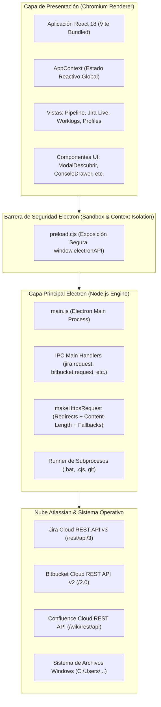
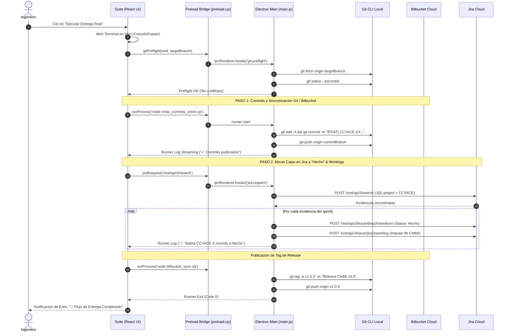

# Arquitectura Técnica & Diagramas de Secuencia

Este documento proporciona una visión profunda de la arquitectura interna de **Atlassian Easier Suite**, orientada a arquitectos de software, mantenedores y auditores técnicos.

---

## 🏛️ 1. Diagrama de Capas del Sistema

---

## ⚡ 2. Diagrama de Secuencia: Flujo de Entrega Real Completo

Muestra la interacción completa cuando el usuario presiona **`Ejecutar Entrega Real`** en la Suite:

---

## 🔒 3. Seguridad y Puentes de Contexto (Context Isolation)

En cumplimiento con las directivas de seguridad de Electron:

1. **`nodeIntegration: false`:** La capa del navegador (React) **no tiene acceso directo** al módulo `child_process` de Node ni a primitivas que puedan vulnerar la máquina cliente.
2. **`contextIsolation: true`:** La ventana del navegador y el script de precarga corren en mundos de ejecución separados.
3. **`preload.cjs`:** Se utiliza la extensión `.cjs` para garantizar que Electron cargue el puente bajo CommonJS nativo sin importar si el proyecto define `"type": "module"` en su `package.json`.
4. **Validación de Parámetros:** Todos los handlers de IPC (`jira:request`, `bitbucket:request`, `dialog:selectDirectory`) sanitizan las rutas locales y las URLs de destino para prevenir cualquier inyección.
