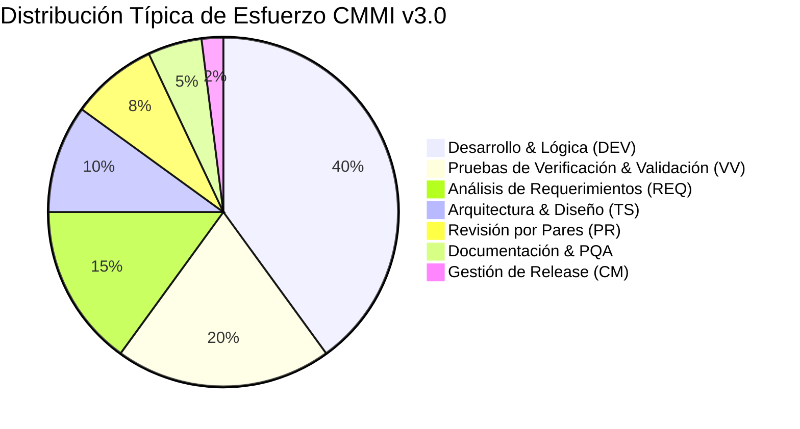
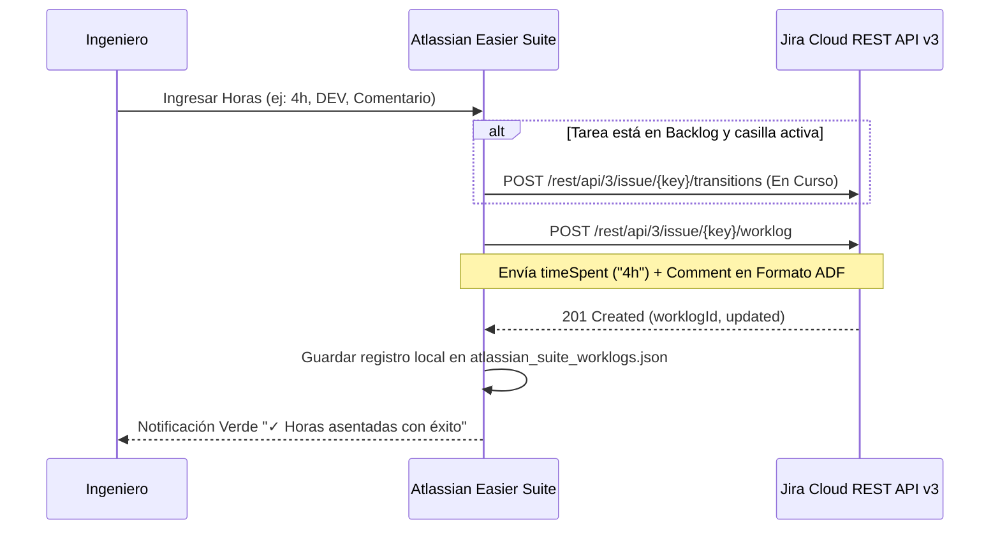

# Bitácora & Imputación de Horas (CMMI v3.0)

El módulo **Bitácora & Horas** resuelve uno de los requerimientos más estrictos de las auditorías de calidad CMMI v3.0: la **trazabilidad del esfuerzo invertido por categoría de proceso** y la imputación formal de tiempos en Jira Cloud (*Worklogs*).

---

## ⏱️ 1. Estructura de Proceso CMMI v3.0

CMMI v3.0 exige categorizar el tiempo de trabajo del equipo según las áreas de práctica del modelo. La Suite organiza la imputación en 7 categorías formadas:



### Tabla de Categorías CMMI

| Código | Categoría | Área CMMI v3.0 | Descripción |
| :---: | :--- | :--- | :--- |
| `analysis` | **Análisis de Requerimientos** | *Requirements Development (RDM)* | Levantamiento de historias de usuario, especificación de criterios de aceptación y casos de uso. |
| `architecture` | **Arquitectura & Diseño** | *Technical Solution (TS)* | Diseño de módulos, modelado de persistencia, diagramas de integración y patrones de software. |
| `development` | **Desarrollo & Codificación** | *Implementation (DEV)* | Construcción de componentes, lógica de negocio y refactorización. |
| `code_review` | **Revisión por Pares** | *Peer Reviews (PR)* | Code reviews en Bitbucket, aprobación de pull requests y verificación de directrices. |
| `testing` | **Pruebas (V&V)** | *Verification & Validation (VV)* | Pruebas unitarias, pruebas de integración, smoke tests y pruebas de regresión. |
| `documentation` | **Documentación & Calidad** | *Process Quality Assurance (PQA)* | Manuales de usuario, actualización de Swagger/OpenAPI y actas de entrega. |
| `release` | **Gestión de Release & Git** | *Configuration Management (CM)* | Sincronización de ramas, resolución de conflictos, etiquetado (*tags*) y publicación de paquetes. |

---

## 📝 2. Cómo Registrar una Bitácora Paso a Paso

1. Accede a la pestaña **`Bitácora & Horas`** desde la barra lateral.
2. **Seleccionar Incidencia Jira:**
   * Puedes elegir cualquier tarea activa desde el menú desplegable (ej: `CCYACE-1: Configuración de Entorno`).
   * La Suite cargará automáticamente la estimación original y el tiempo acumulado hasta la fecha.
3. **Ingresar Tiempo Dedicado:**
   * Admite formato amigable (ej: `4h`, `2h 30m`, `1d`, `45m`).
   * El sistema calcula automáticamente el equivalente decimal (ej: `2h 30m` $\to$ `2.5 hrs`) para métricas de sprint.
4. **Fecha del Trabajo:** Permite registrar trabajo realizado en días previos de la semana en curso.
5. **Seleccionar Categoría CMMI:** Elige una de las 7 categorías reglamentarias.
6. **Comentario Descriptivo:** Describe el entregable técnico producido (este texto se formateará bajo el estándar ADF de Atlassian para una visualización enriquecida en Jira).
7. **Opción `Mover a En Curso si está Por Hacer`:** Si la tarea aún estaba en el Backlog, marcar esta casilla cambiará su estado automáticamente a *En Curso*.
8. Haz clic en **`Registrar Horas en Jira`**.

---

## 🔄 3. Sincronización Técnica con Jira Cloud

Cuando presionas el botón de registro, el motor de Electron realiza la siguiente transacción:



---

## 💾 4. Persistencia Local y Respaldo Offline

Todas las bitácoras generadas se guardan de forma local en:

```text
%APPDATA%\atlassian_suite_worklogs.json
```

Esto asegura que:
* Cuentas con un histórico inmutable de horas imputadas durante el proyecto.
* Si la red corporativa o la API de Atlassian sufren intermitencias temporales, el registro local permanece resguardado para reintentar la sincronización posterior.
