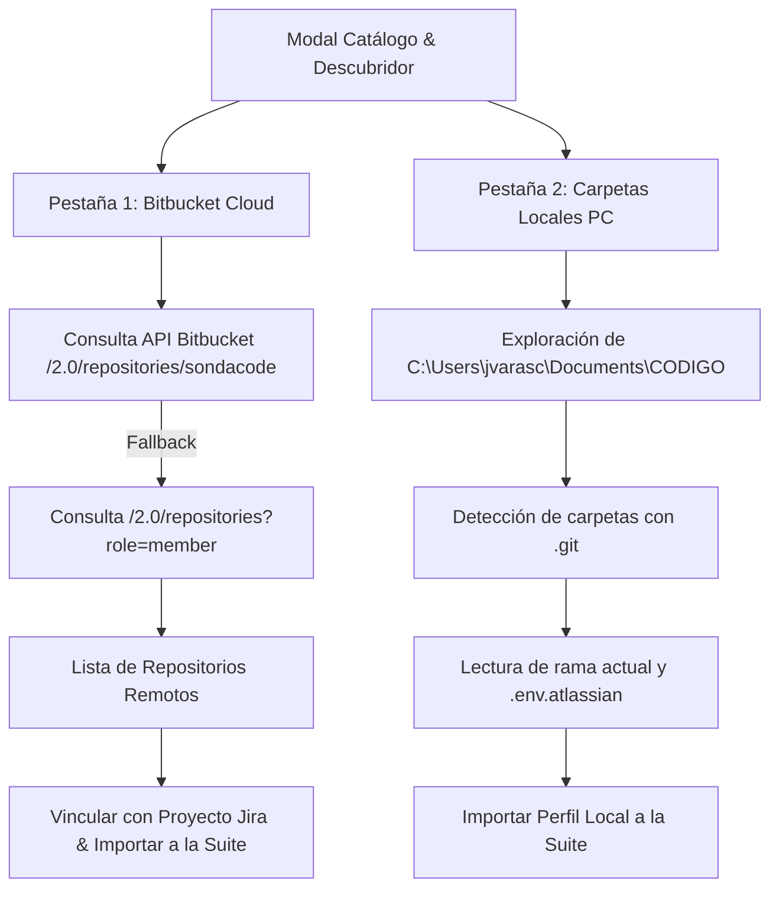

# Catálogo Multi-Proyecto & Bitbucket Cloud

**Atlassian Easier Suite** está diseñada para trabajar con múltiples proyectos simultáneos, permitiendo a los ingenieros alternar entre diferentes iniciativas corporativas (ej: *Cotizador Claude Corporativo*, *GESPAD SII*, etc.) sin tener que reconfigurar credenciales ni rutas cada vez.

---

## 🌐 1. Catálogo Inteligente de Repositorios

El modal de descubrimiento se activa haciendo clic en el botón **`Repositorios Bitbucket`** del Navbar o desde la vista de Perfiles:

---

## ☁️ 2. Pestaña 1: Repositorios Bitbucket Cloud

Esta pestaña se comunica en tiempo real con la API de Bitbucket Cloud (`api.bitbucket.org`):

### Funcionalidades de la Vista

1. **Buscador Dinámico:** Filtra instantáneamente por nombre o *slug* del repositorio (ej: `gespad`, `cotizador`, `portal`, `sii`).
2. **Estrategia Resiliente de Descubrimiento:**
   * Primero consulta los repositorios dentro del workspace corporativo configurado (`sondacode`).
   * Si el usuario no tiene permisos administrativos globales sobre el workspace pero sí es colaborador en repositorios específicos, el sistema ejecuta un fallback transparente consultando `/2.0/repositories?role=member`.
   * Esto garantiza que repositorios compartidos como `gespad-sii` se listen siempre.
3. **Mapeo de Clave Jira:** Por cada repositorio listado, la Suite sugiere automáticamente la clave de proyecto Jira asociada (ej: `GES` para GESPAD, `CCYACE` para Cotizador).
4. **Vincular Carpeta Local:** Si ya tienes el repositorio clonado en tu equipo, puedes asignarle su carpeta local directamente desde la tarjeta del repositorio.
5. **Botón `Importar`:** Incorpora el repositorio como un nuevo perfil activo en la Suite.

---

## 💻 3. Pestaña 2: Carpetas Locales en mi PC

Permite escanear carpetas en tu máquina para descubrir proyectos existentes sin necesidad de descargarlos nuevamente:

### Proceso de Escaneo Local

1. **Ruta Base:** Por defecto apunta a `C:\Users\jvarasc\Documents\CODIGO`.
2. **Botón `📂 Examinar...`:** Permite elegir cualquier otra unidad o carpeta contenedora de tus proyectos.
3. **Detección Automática:**
   * Identifica qué carpetas poseen control de versiones Git (`.git/HEAD`).
   * Lee el nombre de la rama activa (`develop`, `main`, `master`, etc.).
   * Extrae la URL del repositorio remoto (`git remote get-url origin`).
   * Comprueba si el proyecto ya fue importado a la Suite para no duplicar perfiles.
4. **Importación Rápida:** Al presionar `➕ Importar`, el proyecto queda listo para usarse inmediatamente en el selector superior.

---

## ⚙️ 4. Administración de Perfiles de Proyecto

En la sección lateral **Perfiles de Proyecto** puedes afinar la configuración de cada iniciativa:

| Campo | Propósito | Ejemplo |
| :--- | :--- | :--- |
| **Nombre del Perfil** | Etiqueta descriptiva para el selector | `Cotizador Claude Corporativo (SONDA)` |
| **Ruta del Proyecto** | Directorio físico del código en Windows | `C:\Users\jvarasc\Documents\CODIGO\COTIZADOR` |
| **Modelo de Gobernanza** | Estándar de calidad para commits y entregas | `CMMI Híbrido`, `CMMI Estricto`, `Ágil` |
| **Rama Objetivo** | Rama de entrega y verificación Git | `develop`, `main` |
| **Clave de Proyecto Jira** | Prefijo de las incidencias en Jira Cloud | `CCYACE`, `GES` |
| **ID de Tablero Jira** | Identificador numérico del tablero Scrum/Kanban | `6013` |
| **Workspace Bitbucket** | Espacio de trabajo corporativo en la nube | `sondacode` |
| **Slug del Repositorio** | Nombre del repositorio en Bitbucket | `cotizador-claude-corporativo`, `gespad-sii` |
| **Espacio Confluence** | Clave del espacio para actas y evidencias | `CCYACE` |

> [!TIP]
> Si colocas un archivo `.env.atlassian` en la raíz de cualquier carpeta de proyecto, la Suite leerá automáticamente todos estos parámetros sin que tengas que escribirlos a mano.
