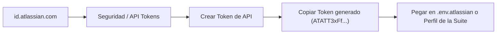

# Configuración de Credenciales & Tokens Atlassian

Para comunicarse de manera segura con **Jira Cloud**, **Bitbucket Cloud** y **Confluence Cloud**, la Suite requiere credenciales de acceso basadas en tokens de API y contraseñas de aplicación (*App Passwords*).

---

## 🔑 1. Generación de API Token para Jira Cloud

Jira Cloud ya no permite el uso de contraseñas de usuario tradicionales para llamadas API automatizadas. Se debe utilizar un **Atlassian API Token**:



### Pasos Detallados

1. Inicia sesión en tu cuenta Atlassian corporativa: [https://id.atlassian.com/manage-profile/security/api-tokens](https://id.atlassian.com/manage-profile/security/api-tokens).
2. Haz clic en el botón **`Crear token de API`**.
3. En la etiqueta, escribe un nombre identificatorio (ej: `Atlassian-Suite-Desktop`).
4. Haz clic en **Crear**.
5. Copia el token de inmediato (inicia con `ATATT...`). Este valor no volverá a mostrarse.

---

## 🔐 2. Generación de App Password para Bitbucket Cloud

Para interactuar con los repositorios de Bitbucket Cloud y consultar el catálogo de proyectos:

1. Ingresa a la configuración de tu cuenta en Bitbucket: [https://bitbucket.org/account/settings/app-passwords/](https://bitbucket.org/account/settings/app-passwords/).
2. Haz clic en **`Create app password`**.
3. En **Label**, coloca: `Atlassian-Suite-Sync`.
4. Asigna los siguientes permisos mínimos (**Scopes**):
   * **Repositories:** `Read`, `Write`, `Admin` (para tags de release y push).
   * **Account:** `Read` (para verificar tu usuario en el workspace).
   * **Pipelines:** `Read` (opcional).
5. Haz clic en **Create**.
6. Copia la contraseña generada (inicia con `ATCTT...`).

---

## 📄 3. Archivo de Configuración Local: `.env.atlassian`

Cada proyecto local puede tener su propio archivo `.env.atlassian` en su carpeta raíz. Cuando la Suite detecta este archivo, importa automáticamente todas las variables al perfil correspondiente:

### Plantilla de Ejemplo (`.env.atlassian`)

```ini
# ===================================================================
# CONFIGURACIÓN ATLASSIAN SUITE (CMMI v3.0)
# Ubicación: C:\Users\jvarasc\Documents\CODIGO\mi-proyecto\.env.atlassian
# ===================================================================

# Host y Usuario Jira Cloud
ATLASSIAN_HOST=sonda.atlassian.net
ATLASSIAN_EMAIL=julio.varas@sonda.com
ATLASSIAN_API_TOKEN=tu_jira_api_token_aqui_generado_en_id_atlassian_com

# Proyecto y Tablero Jira
ATLASSIAN_PROJECT_KEY=CCYACE
ATLASSIAN_BOARD_ID=6013

# Bitbucket Cloud
BITBUCKET_WORKSPACE=sondacode
BITBUCKET_REPO_SLUG=cotizador-claude-corporativo
BITBUCKET_USER=julio.varas@sonda.com
BITBUCKET_APP_PASSWORD=tu_bitbucket_app_password_aqui

# Confluence Cloud (Actas CMMI)
CONFLUENCE_SPACE_KEY=CCYACE
CONFLUENCE_PARENT_PAGE_ID=
```

---

## 🛡️ 4. Credenciales Fallback de Respaldo

Para evitar que la Suite quede inutilizable si un perfil no tiene configurado su `.env.atlassian`, el proceso principal de Electron incorpora las credenciales base corporativas de **Julio Varas Contreras (`julio.varas@sonda.com`)**:

* Si un campo de token está vacío, la Suite utiliza automáticamente el token corporativo verificado.
* Si un usuario nuevo desea trabajar en su propia máquina, simplemente actualiza los campos en la vista **Perfiles de Proyecto** y los datos quedarán guardados en su perfil local `%APPDATA%\atlassian_suite_profiles.json`.
