# Smoke Test vs Ejecución Real: Guía de Pipeline

La Suite proporciona una clara distinción entre la validación pasiva y la entrega real de software, permitiendo a los ingenieros verificar el estado del entorno sin alterar datos de producción.

---

## 🧭 1. Comparativa de Modos de Operación

```mermaid
flowchart TD
    subgraph SmokeTest ["🧪 Smoke Test (Solo Lectura)"]
        S1["Verifica API Token Jira"] --> S2["Verifica Conexión Bitbucket"]
        S2 --> S3["Verifica Espacio Confluence"]
        S3 --> S4["Escanea Scripts .BAT locales"]
        S4 --> S5["✓ Muestra Conteo de Incidencias (0 Escrituras)"]
    end

    subgraph RealRun ["🚀 Ejecución Real (Entrega CMMI)"]
        R1["Git Preflight Concurrente"] --> R2["[Paso 1] Generar Commits & Push Bitbucket"]
        R2 --> R3["[Paso 2] Mover Cajas Jira a 'Hecho' & Worklogs"]
        R3 --> R4["Publicar Tag de Release en Bitbucket"]
        R4 --> R5["[Paso 3] Compilación Opcional de Instalable"]
    end
```



---

## 🧪 2. Modo Smoke Test (Diagnóstico Pasivo)

### ¿Cuándo usarlo?
* Al iniciar tu jornada laboral para comprobar que tus credenciales de Atlassian siguen vigentes.
* Al cambiar de red (ej: conectarse a VPN o cambiar de sede física).
* Al vincular una nueva carpeta de proyecto antes de ejecutar cualquier script por lotes.

### Salida esperada en la Terminal
```text
=======================================================================
  🧪 DIAGNÓSTICO & SMOKE TEST (SOLO LECTURA / SIN MODIFICAR DATOS)
  Proyecto: Cotizador Claude Corporativo (SONDA CCYACE)
  Directorio: C:\Users\jvarasc\Documents\CODIGO\COTIZADOR
  Modo: Verificación de Conectividad Atlassian & Detección de Scripts
=======================================================================

[1/3] Probando conexión Jira Cloud (API Token & Usuario)...
  ✓ Jira OK: Conectado como Julio Varas Contreras (julio.varas@sonda.com)
  ✓ Proyecto CCYACE accesible: 14 incidencias detectadas en backlog/sprint.

[2/3] Probando conexión Bitbucket Cloud (Repo & Workspace)...
  ✓ Bitbucket OK: Repositorio sondacode/cotizador-claude-corporativo accesible.

[3/3] Probando conexión Confluence Cloud (Espacio Documental)...
  ✓ Confluence OK: Espacio CCYACE verificado.

[VERIFICACIÓN DE SCRIPTS LOCALES]
  ✓ Detectado script de commits: crear_commits_cmmi.cjs
  ✓ Detectado script de sincronización: bitbucket_sync.cjs
  ✓ Detectado flujo por lotes: ejecutar_flujo_completo.bat

=======================================================================
  SMOKE TEST COMPLETADO: SISTEMA 100% LISTO PARA ENTREGA REAL
=======================================================================
```

---

## 🚀 3. Modo Ejecución Real (Entrega CMMI v3.0)

### ¿Qué ocurre internamente?

1. **Git Preflight:** Compara tu rama contra `origin/<targetBranch>` para asegurar que nadie más haya integrado cambios conflictivos.
2. **Paso 1: Commits y Sincronización Git / Bitbucket:**
   * Invoca `node crear_commits_cmmi.cjs`.
   * Formatea los mensajes con el estándar CMMI configurado (`[FEAT] CCYACE-XX: ...`).
   * Sube los cambios a Bitbucket Cloud (`git push origin <activeBranch>`).
3. **Paso 2: Mover Cajas en Jira a "Hecho" & Confluence:**
   * Invoca `node atlassian_sync.cjs`.
   * Realiza la llamada `POST /rest/api/3/issue/{key}/transitions` cambiando el estado a *Hecho*.
   * Asienta las horas trabajadas en los Worklogs de cada tarjeta.
   * Genera el acta de sprint en Confluence.
   * Publica el tag de release en Bitbucket (ej: `v1.0.3`).
4. **Paso 3: Compilar y Empaquetar Ejecutables (.exe / .zip):**
   * *(Opcional)* Si está marcado, compila la aplicación para distribución offline.

---

## ⏹️ 4. Abortar Ejecución en Curso

Si por cualquier motivo requieres detener el flujo mientras se ejecuta:
* El botón principal se transforma en **`⏹️ Abortar Ejecución en Curso`** con animación pulsante.
* Al presionarlo, la Suite envía la señal de terminación (`SIGTERM` / `taskkill`) al proceso hijo de Node.js, liberando los bloqueos sobre el repositorio de inmediato.
