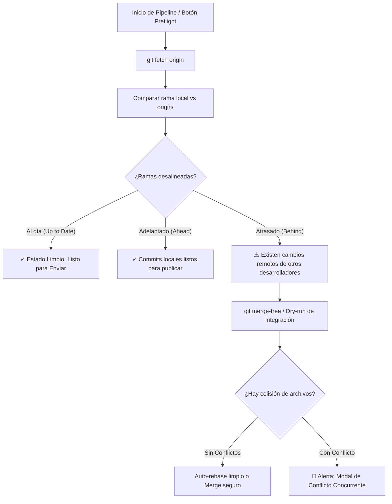
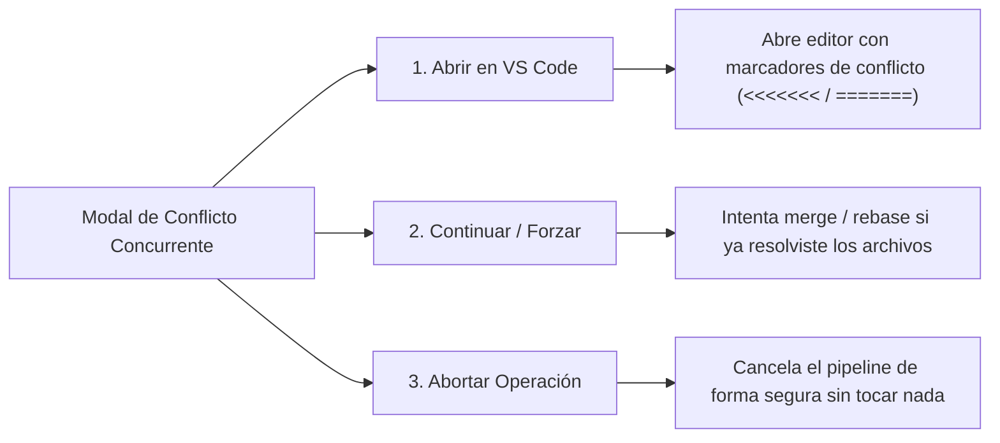

# Flujo Git Concurrente & Resolución de Conflictos

Uno de los problemas más frecuentes en equipos de desarrollo es la **colisión de cambios** cuando varios ingenieros trabajan sobre la misma rama (`develop`, `feature/`, etc.) y realizan pushes concurrentes.

**Atlassian Easier Suite** incorpora un motor preventivo denominado **Git Preflight Engine** que inspecciona el estado remoto antes de ejecutar cualquier push o mover tarjetas en Jira.

---

## 🛡️ 1. Motor de Preflight Git: ¿Cómo Funciona?

Antes de que el pipeline intente publicar código en Bitbucket Cloud, ejecuta un análisis en segundo plano:

---

## 🚨 2. Detección Preventiva de Conflictos

Si otro desarrollador envió cambios a Bitbucket sobre los mismos archivos que modificaste localmente:

1. El sistema **detiene inmediatamente el pipeline** antes de crear commits rotos o dejar el repositorio en estado inconsistente.
2. Emite una advertencia visual en la terminal y abre el **Modal de Conflicto Concurrente**:
   * Muestra la lista exacta de archivos en colisión (ej: `src/components/PipelineView.tsx`, `package.json`).
   * Indica cuántos commits remotos están pendientes de descargar.
   * Evita transicionar tarjetas a "Hecho" en Jira si el código aún no se ha podido integrar limpiamente.

---

## 🛠️ 3. Opciones de Resolución en Pantalla

El modal ofrece tres alternativas guiadas para resolver la situación sin perder trabajo:

### 3.1 Opción 1: `Abrir en VS Code` (Recomendada)
* La Suite invoca el comando de sistema `code .` en la carpeta del proyecto.
* Abre Visual Studio Code directamente con los archivos en conflicto resaltados.
* El desarrollador puede usar el comparador visual (*Accept Current Change*, *Accept Incoming Change*, *Accept Both*).
* Una vez resuelto y guardado el archivo en VS Code, regresas a la Suite y presionas **Continuar**.

### 3.2 Opción 2: `Continuar / Reintentar`
* Si ya resolviste los marcadores de conflicto en tu editor de código o terminal, este botón verifica que no queden marcadores `<<<<<<< HEAD` residuales y reanuda el pipeline de entrega automáticamente.

### 3.3 Opción 3: `Abortar Operación`
* Cancela el intento de entrega de inmediato.
* Deja tu espacio de trabajo local exactamente en el estado en que se encontraba antes de pulsar *Ejecutar Entrega Real*.
* No realiza transiciones de tarjetas en Jira ni genera tags en Bitbucket.

---

## 💡 Buenas Prácticas para Equipos Concurrentes

1. **Ejecuta `Preflight Concurrente` al inicio de tu jornada:** Verifica si tus compañeros han integrado cambios nuevos mientras estabas offline.
2. **Usa ramas temáticas cortas:** Nombra tus ramas bajo el esquema `feature/<CLAVE-JIRA>-<tarea>` en lugar de desarrollar todos directamente sobre `develop`.
3. **Imputa tus horas progresivamente:** No esperes al final de la semana para asentar bitácoras; el registro diario mantiene las métricas del sprint actualizadas en Jira.
