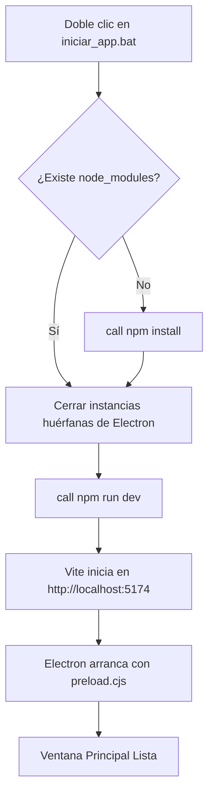
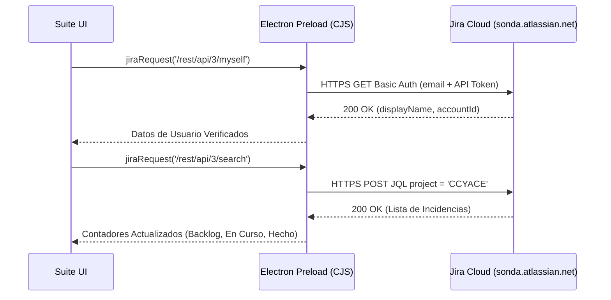

# Guía de Inicio Rápido (Quickstart)

Esta guía te permitirá poner en marcha **Atlassian Easier Suite** en menos de 2 minutos en un entorno Windows corporativo.

---

## 📋 Requisitos Previos

* **Sistema Operativo:** Windows 10 u 11 (64-bit).
* **Node.js:** Versión 18 LTS o superior (recomendado Node 20+).
* **Git for Windows:** Instalado y disponible en el `PATH` del sistema.
* **Credenciales Atlassian:**
  * Usuario / Correo corporativo (ej: `julio.varas@sonda.com`).
  * API Token de Jira Cloud generado en [id.atlassian.com](https://id.atlassian.com/manage-profile/security/api-tokens).
  * App Password o Access Token de Bitbucket Cloud generado en [bitbucket.org/account/settings/app-passwords/](https://bitbucket.org/account/settings/app-passwords/).

---

## 🚀 Paso 1: Lanzamiento de la Aplicación

Para garantizar compatibilidad con las directivas de seguridad corporativas de Windows (AppLocker / Directivas de Grupo que bloquean invocaciones manuales de PowerShell), la aplicación se inicia directamente a través del script por lotes verificado:

```cmd
iniciar_app.bat
```

### ¿Qué hace `iniciar_app.bat` automáticamente?



1. **Inspección de Entorno:** Valida la presencia de `node.exe` y `npm.cmd` en las rutas del sistema.
2. **Cierre de Procesos Huérfanos:** Termina cualquier proceso `electron.exe` colgado en segundo plano (`taskkill /F /IM electron.exe`).
3. **Compilación de Preload Seguro:** Vite compila `electron/preload.ts` hacia `dist-electron/preload.cjs` bajo formato CommonJS puro para evitar incompatibilidades con módulos ES.
4. **Despliegue del Frontend:** Abre la ventana nativa de Electron conectada al servidor Vite en `http://localhost:5174/`.

---

## 🔍 Paso 2: Verificación de Conectividad Inicial

Al abrirse la aplicación, el sistema realiza automáticamente una comprobación no intrusiva de credenciales:



### Indicadores Visuales de Éxito

* **Chip Jira en el Navbar:** Deberá mostrar un punto verde pulsante:
  $$\text{● Conectado a sonda.atlassian.net}$$
* **Tarjeta de Responsable:** Identifica al usuario activo (ej: *Julio Varas Contreras*).
* **Contadores de Incidencias:** Se poblarán los números en las tarjetas **Por Hacer**, **En Curso** y **Hecho** según el estado actual en el tablero Jira.

---

## 📂 Paso 3: Vinculación de la Carpeta Local

Si tu perfil indica `⚠️ Sin Carpeta Asignada`:

1. Haz clic en el botón **`Examinar Carpeta...`** ubicado en el panel central.
2. Se abrirá el selector nativo de carpetas de Windows.
3. Selecciona la carpeta donde tienes clonado el repositorio (por ejemplo, `C:\Users\jvarasc\Documents\CODIGO\COTIZADOR_CLAUDE_CORPORATIVO` o `gespad-sii`).
4. La Suite escaneará automáticamente:
   * La rama Git activa (`develop`, `main`, `feature/...`).
   * La existencia del archivo `.env.atlassian` con tokens del proyecto.
   * La disponibilidad de scripts `.bat` y `.cjs` para el pipeline.

---

## 🧪 Paso 4: Ejecución del Smoke Test (Diagnóstico Pasivo)

Antes de realizar cualquier entrega real, ejecuta un **Smoke Test**:

1. En la barra superior, haz clic en el botón **`Smoke Test (Solo Lectura)`**.
2. Se abrirá la **Terminal en Vivo**.
3. El sistema verificará en 3 etapas:
   * `[1/3] Conexión Jira Cloud`: Consulta de usuario y conteo de tareas.
   * `[2/3] Conexión Bitbucket Cloud`: Validación de repositorio y permisos de workspace.
   * `[3/3] Conexión Confluence Cloud`: Comprobación del espacio de entregables.
   * `[VERIFICACIÓN SCRIPTS]`: Detección de `crear_commits_cmmi.cjs` y archivos por lotes.
4. **Garantía:** El Smoke Test **nunca** modifica tarjetas en Jira, ni crea commits, ni altera ramas en Bitbucket.
