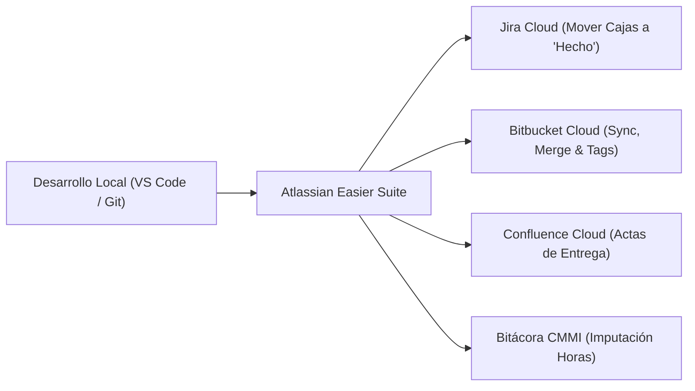
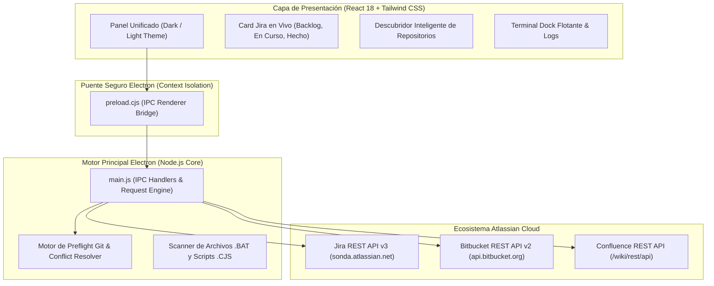

# Atlassian Easier Suite — Manual de Operación y Gobernanza (CMMI v3.0)

Bienvenido a la documentación oficial y manual operativo de **Atlassian Easier Suite**, la plataforma de automatización de escritorio diseñada para agilizar el ciclo de entrega de software, sincronización de repositorios Git en **Bitbucket Cloud**, transición de incidencias en **Jira Cloud** e imputación automatizada de bitácoras conforme al marco de calidad **CMMI v3.0**.

---

## 🎯 Propósito del Sistema

El objetivo fundamental de la Suite es **eliminar la carga manual y repetitiva** que los ingenieros de software, líderes técnicos y auditores de calidad enfrentan al cerrar sprints o liberar versiones:

### Problemas que Resuelve

1. **Retraso en la transición de tarjetas Jira:** Automatiza el movimiento de historias desde *Por Hacer* / *En Curso* hacia *Hecho* con validación de estimaciones y comentarios ADF (*Atlassian Document Format*).
2. **Desincronización de ramas concurrentes:** Incluye inspección previa (*Git Preflight*) para equipos que comparten ramas comunes (`develop`, `feature/`, `release/`), evitando colisiones de *merge* y abortos imprevistos.
3. **Imputación fragmentada de horas:** Centraliza la bitácora semanal y distribuye el esfuerzo en categorías CMMI v3.0 (Análisis, Arquitectura, Desarrollo, Pruebas VV, Revisión por Pares).
4. **Independencia de compilación pesada:** Permite ejecutar la sincronización de Jira y Bitbucket en segundos, dejando la compilación de instalables pesados (`.exe` / `.zip`) como un paso desacoplado y opcional.

---

## 🏗️ Arquitectura y Componentes Clave

La aplicación está construida sobre una arquitectura híbrida de alto rendimiento:

---

## 📌 Módulos Principales de la Suite

| Módulo | Icono | Descripción |
| :--- | :---: | :--- |
| **Pipeline & .BAT** | 🚀 | Orquestación del flujo de entrega en 3 pasos: Git push, transición de Jira y empaquetado opcional. Diferenciación estricta entre *Smoke Test* (lectura) y *Ejecución Real*. |
| **Tablero Jira en Vivo** | 📋 | Consulta en tiempo real de las incidencias del proyecto activo (`CCYACE`, `GES`, etc.), con contadores de estado y auto-asignación al usuario responsable. |
| **Catálogo de Repositorios** | 🌐 | Descubrimiento bidireccional: explora repositorios del workspace corporativo (`sondacode`) en Bitbucket Cloud y detecta carpetas con Git en tu PC. |
| **Bitácora & Horas** | ⏱️ | Registro semanal de horas con categorización CMMI v3.0, cálculo de porcentajes y sincronización como *Worklogs* en Jira Cloud. |
| **Git Preflight Concurrente** | 🌿 | Análisis de ramas remotas antes de enviar código, alertando si la rama está desactualizada (*behind*) o en conflicto de merge con otros desarrolladores. |
| **Perfiles de Proyecto** | ⚙️ | Gestión de configuraciones independientes por cliente/proyecto con carga automática desde `.env.atlassian`. |

---

## 🚦 Primeros Pasos Recomendados

Para comenzar a operar la Suite sin iteraciones ni bloqueos:

1. Lee la [Guía de Inicio Rápido](guia_rapida.md) para lanzar la aplicación correctamente.
2. Consulta el [Manual de Usuario](manual_usuario.md) para comprender cada control en pantalla.
3. Revisa la sección de [Configuración & Credenciales](configuracion_credenciales.md) para verificar tus tokens Atlassian.
4. Si experimentas algún mensaje de advertencia, consulta la [Guía de Resolución de Problemas](resolucion_problemas.md).
