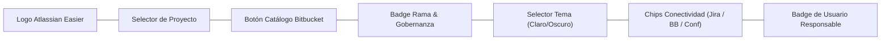
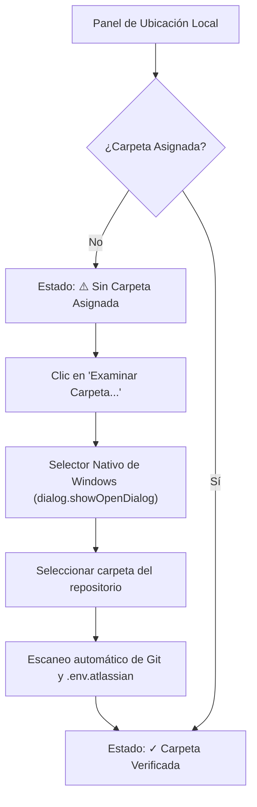

# Manual de Usuario y Operación

Este manual detalla cada pantalla, botón y funcionalidad de **Atlassian Easier Suite**, guiándote paso a paso en su operación cotidiana.

---

## 🧭 1. Barra de Navegación Superior (Navbar)

La barra superior permanece accesible en todas las vistas de la Suite y proporciona el control global de sesión y estado:

### Controles del Navbar

1. **Selector de Proyecto:** Desplegable para alternar instantáneamente entre diferentes proyectos configurados (ej: *Cotizador Claude Corporativo*, *GESPAD SII*, etc.).
2. **Botón `🌐 Repositorios Bitbucket`:** Abre el modal de descubrimiento para importar repositorios de la nube o carpetas locales de tu equipo.
3. **Badge de Rama Objetivo (`🌿 develop` / `main`):** Indica hacia qué rama remota se verificarán las colisiones de merge y se publicarán los commits.
4. **Badge de Gobernanza (`CMMI Estricto` / `CMMI Híbrido` / `Ágil`):** Muestra la regla de nombrado de commits y validaciones de calidad que rigen el proyecto.
5. **Selector de Tema (`🌙 Oscuro` / `☀️ Claro`):** Alterna el esquema visual de la interfaz. La preferencia se guarda automáticamente en `localStorage`.
6. **Chips de Conectividad en Tiempo Real:**
   * **Jira:** Verde (`● Conectado`) si el token y usuario responden exitosamente; Rojo si hay error de autenticación.
   * **Bitbucket:** Indica vinculación con el repositorio remoto.
   * **Confluence:** Muestra el estado del espacio documental de evidencias.
7. **Badge de Usuario:** Avatar y nombre del responsable registrado en Atlassian (ej: *Julio Varas Contreras*).

---

## 🚀 2. Vista Principal: Pipeline & .BAT

Esta es la pantalla de control central donde se coordinan las entregas y la sincronización con Atlassian.

### 2.1 Tablero Jira en Vivo (Jira Live Card)

Ubicada en la parte superior del panel, muestra el estado actual del sprint o backlog sin necesidad de abrir el navegador:

* **Contador `Por Hacer (Backlog)`:** Total de historias o tareas pendientes en el proyecto activo.
* **Contador `En Curso (Activas)`:** Tareas en ejecución actual con indicador de actividad.
* **Contador `Hecho (Finalizadas)`:** Tareas completadas exitosamente.
* **Botón `Refrescar Jira`:** Fuerza una nueva consulta a Jira Cloud para sincronizar cambios realizados por otros miembros del equipo.
* **Botón `Sincronizar de .env`:** Si se detecta un error de autenticación, lee las credenciales actualizadas del archivo `.env.atlassian` local.

---

### 2.2 Vinculación y Selección de Carpeta Local

El panel central gestiona la ubicación del código fuente en tu disco duro:

* **Botón `Examinar Carpeta...`:** Abre el explorador de archivos nativo de Windows para que elijas la carpeta raíz del proyecto.
* **Enlace `Editar`:** Permite escribir o pegar manualmente una ruta absoluta (ej: `C:\Users\jvarasc\Documents\CODIGO\mi-proyecto`) y presionar *Guardar*.
* **Auto-Sincronización:** Si la carpeta contiene `.env.atlassian`, los tokens y claves de proyecto se importan automáticamente al perfil activo.

---

### 2.3 Barra de Gobernanza, Ramas y Preflight Concurrente

Permite ajustar la estrategia de Git antes de iniciar el pipeline:

* **Rama Local:** Muestra la rama Git en la que te encuentras trabajando actualmente (ej: `feature/CCYACE-1-setup-inicial` o `develop`).
* **Selector Rama Objetivo:** Define la rama contra la cual se validará el flujo (`develop` para equipos activos, `main` para producción).
* **Selector Gobernanza:**
  * *CMMI Híbrido:* Mensajes de commit con formato `[TIPO] CCYACE-XX: Descripción` adaptados a equipos concurrentes.
  * *CMMI v3.0 Estricto:* Auditoría formal, trazabilidad cruzada y checklist PQA obligatorio.
  * *Ágil Estándar:* Commits directos convencionales sin prefijos estrictos.
* **Botón `Preflight Concurrente`:** Ejecuta un análisis de Git en segundo plano comparando tu rama local contra `origin/<rama_objetivo>`, alertándote si otros desarrolladores han subido cambios que puedan causar conflictos.

---

## ⚡ 3. Secuencia de Entrega: Smoke Test vs Ejecución Real

Para evitar modificaciones accidentales en Jira o repositorios, la Suite separa estrictamente el diagnóstico de la ejecución:

| Característica | 🧪 Smoke Test (Solo Lectura) | 🚀 Ejecución Real (Entrega CMMI) |
| :--- | :---: | :---: |
| **Objetivo** | Comprobar salud de credenciales y rutas | Mover tarjetas, registrar horas y subir código |
| **Modifica Jira** | ❌ No altera tarjetas | ✅ Transiciona tarjetas a "Hecho" |
| **Imputa Horas** | ❌ Solo lectura | ✅ Crea Worklogs en Jira |
| **Git Push** | ❌ No realiza push | ✅ Sincroniza commits con Bitbucket |
| **Peligro de Regresión** | Cero riesgo (100% pasivo) | Modifica datos en vivo |

### Pasos de la Secuencia de Entrega

1. **[1/3] Commits y Sincronización Git / Bitbucket:** Prepara los commits estructurados, sincroniza con `origin` y publica el tag de release.
2. **[2/3] Mover Cajas en Jira a "Hecho" & Confluence:** Transiciona las tarjetas del sprint al estado final, registra las bitácoras semanales y genera el acta en Confluence.
3. **[3/3] Compilar y Empaquetar Ejecutables (.exe / .zip):** *(Opcional)* Genera los instalables para entrega offline. Viene desactivado por defecto para agilizar la entrega Atlassian en menos de 10 segundos.

---

## 💻 4. Terminal en Vivo & Consola Flotante

La terminal inferior está desacoplada del flujo visual para mantener la pantalla limpia:

* **Dock en Reposo:** Muestra un indicador circular (verde si hay proceso en curso, azul en reposo), la cantidad de líneas registradas y el texto del último evento.
* **Botón `Abrir Consola`:** Despliega una consola flotante tipo modal/drawer que muestra la salida en tiempo real de Node.js, scripts por lotes y llamadas a la API de Atlassian.
* **Botón `Copiar`:** Copia todos los logs de ejecución al portapapeles para adjuntar a reportes de soporte o actas CMMI.
* **Botón `Limpiar`:** Vacía el buffer de texto de la terminal.
* **Botón `Minimizar`:** Oculta la terminal; los procesos continúan ejecutándose de fondo sin interrupciones.
