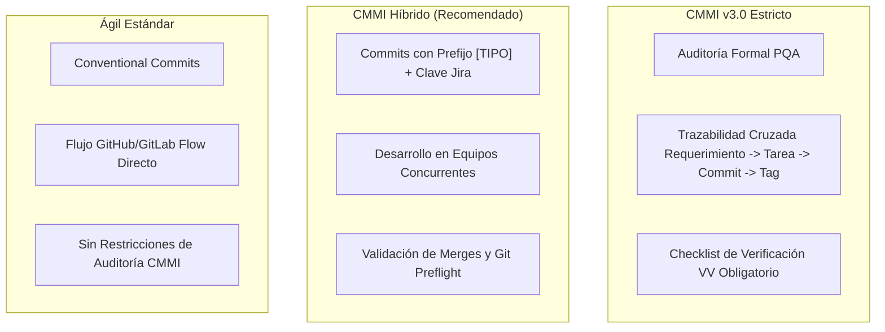
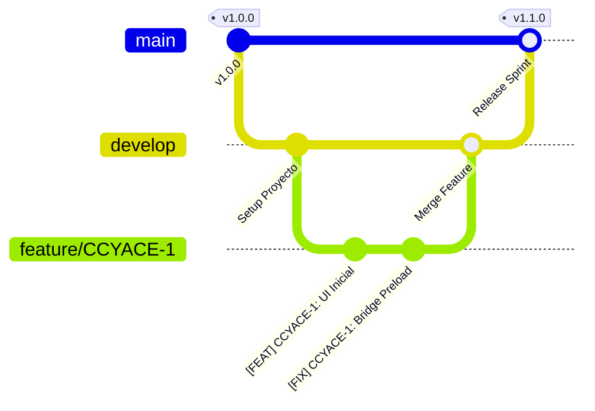

# Modelos de Gobernanza: CMMI v3.0 vs Ágil

**Atlassian Easier Suite** permite adaptar el nivel de rigor formal de cada proyecto a través de tres perfiles de gobernanza: **CMMI v3.0 Estricto**, **CMMI Híbrido** y **Ágil Estándar**.

---

## 📊 1. Comparativa de Modelos de Gobernanza



| Criterio | CMMI v3.0 Estricto | CMMI Híbrido (Default) | Ágil Estándar |
| :--- | :--- | :--- | :--- |
| **Uso Típico** | Auditorías formales de certificación, proyectos bancarios o licitaciones públicas. | Equipos de desarrollo ágiles con múltiples desarrolladores en la misma rama. | Proyectos internos, prototipos rápidos y herramientas de apoyo. |
| **Estructura de Commits** | Prefijo semántico obligatorio + ID Jira + Área CMMI + Revisor. | Prefijo semántico + ID Jira + Resumen claro. | Mensaje libre o Conventional Commits estándar (`feat:`, `fix:`). |
| **Ramas Objetivo** | `release/vX.Y.Z` $\to$ `main`. | `develop` para trabajo diario; `main` para entregas. | Directo a `main` o ramas de corta duración. |
| **Documentación** | Acta formal en Confluence con matriz de evidencias. | Registro automático en Confluence de sprint y cambios. | Opcional / Markdown en repositorio. |
| **Sincronización Jira** | Cierre con validación de horas estimadas vs reales. | Movimiento a "Hecho" con registro de bitácora. | Transición directa sin restricción de horas. |

---

## 🔤 2. Estándar de Mensajes de Commit

### 2.1 Formato CMMI v3.0 Estricto
```text
[ÁREA] CLAVE-JIRA: Descripción técnica del cambio | CMMI-PRÁCTICA | Evidencia
```
* **Ejemplo:**
  `[DEV] CCYACE-1: Implementación de arquitectura Electron Preload CJS | CMMI-TS | Verificado en Windows 11`

### 2.2 Formato CMMI Híbrido (Equipos Activos)
```text
[TIPO] CLAVE-JIRA: Resumen funcional del cambio
```
* **Tipos admitidos:**
  * `[FEAT]`: Nueva funcionalidad o pantalla.
  * `[FIX]`: Corrección de errores o bugs.
  * `[REFACTOR]`: Mejoras de rendimiento o código sin alterar la lógica de negocio.
  * `[DOCS]`: Documentación técnica y manuales de usuario.
  * `[TEST]`: Pruebas de integración o smoke tests.
* **Ejemplo:**
  `[FEAT] GES-120: Integración de catálogo dinámico de repositorios Bitbucket`

### 2.3 Formato Ágil Estándar
```text
tipo(alcance): descripción breve
```
* **Ejemplo:**
  `feat(auth): add resilient fallback token headers for bitbucket api`

---

## 🌿 3. Estrategia de Ramificación (Branching Strategy)

Para evitar colisiones entre desarrolladores, la Suite implementa el flujo estándar de Git estructurado:



1. **`main` / `master`:** Contiene código 100% probado y aprobado para producción. Protegida contra pushes directos.
2. **`develop`:** Rama de integración para el equipo de desarrollo. La Suite realiza verificaciones *Preflight* contra esta rama para evitar sobreescrituras.
3. **`feature/<clave-jira>-<descripcion>`:** Rama de trabajo individual donde cada ingeniero codifica su requerimiento (ej: `feature/CCYACE-1-setup-inicial`).
4. **Tags de Versión:** Publicación automática bajo el estándar SemVer (`v1.0.0`, `v1.1.0`, etc.) al completar el pipeline.
